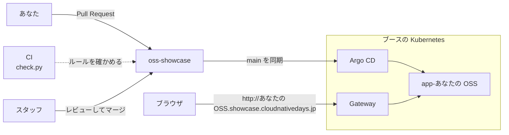

# OSS Showcase

CloudNative Days のブースで動いている Kubernetes に、あなたの OSS をデプロイしてみませんか。

自分で作った OSS でも、好きな OSS でも構いません。
このリポジトリに Pull Request を出してマージされると、1 分ほどで `http://<OSS の名前>.showcase.cloudnativedays.jp` に公開されます。

## しくみ

main にマージされた YAML を、Argo CD がクラスタに同期します。
OSS ごとに専用の namespace が用意され、ほかの人の OSS とは通信も資源も分かれています。

## やってみる

1. このリポジトリを fork する
2. `apps/example/` をコピーして、`apps/<OSS の名前>/` を作る
3. `app.yaml` の 3 か所を書き換える
   - `image`：その OSS のコンテナイメージ
   - `containerPort` と Service の `targetPort`：その OSS が待ち受けるポート
   - HTTPRoute の `hostnames`：`<OSS の名前>.showcase.cloudnativedays.jp`
4. `python3 scripts/check.py` を実行して、`ok` と出ることを確かめる
5. Pull Request を出す。スタッフがレビューしてマージします

## こんなときは

- **Helm チャートしかない**：`helm template` で YAML に展開してコミットしてください。手順は [ルール](docs/rules.md#helm-チャートしかないとき) にあります
- **データベースを使いたい**：CloudNativePG で PostgreSQL を作れます。[ルール](docs/rules.md#postgresql-が要るとき) に例があります
- **Operator のように CRD が要る**：`cluster-apps/` に置きます。スタッフが中身を確認してからマージします
- **Claude Code などのエージェントに任せたい**：[AGENTS.md](AGENTS.md) を読ませてください

## 気をつけてほしいこと

- Secret も使えます。ただし、このリポジトリは公開されていて、書いた値は誰でも読めます。テスト用の値のように、見られても困らないものだけを書いてください
- 管理者のパスワードも誰でも読めるので、誰でもログインできてしまいます。ログインを止めるか、閲覧だけにしてください
- 外への通信は、DNS と HTTP、HTTPS だけが通ります
- 特権コンテナは使えません

CPU やメモリの上限、使えるリソースの種類などの細かいルールは [docs/rules.md](docs/rules.md) にまとめています。
CI で引っかかったときも、ここを見てください。

## ライセンス

[Apache License 2.0](LICENSE)
